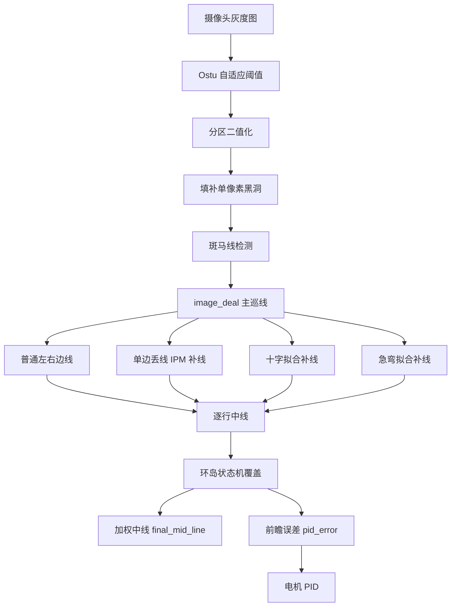
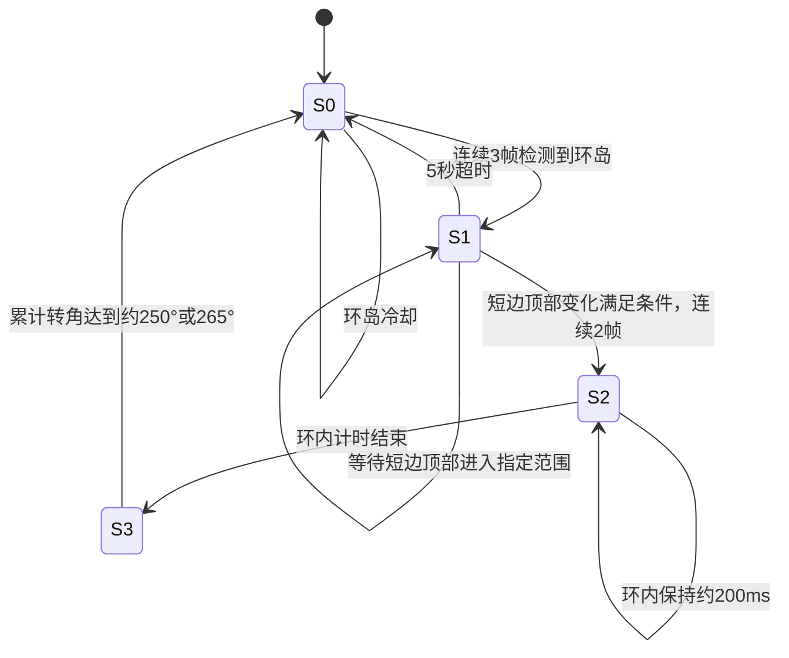

# image.c / image.h 视觉代码详细学习笔记

> 适用工程：`D:\ads\workspace 4+ - 350版本`
>
> 主要源码：
>
> - `Seekfree_TC264_Opensource_Library/code/image.c`
> - `Seekfree_TC264_Opensource_Library/code/image.h`
>
> 图像尺寸：`188 × 120`

---

## 0. 先看结论

这套视觉不是单纯“找一条黑线”，而是一套典型的智能车摄像头巡线方案：

1. 获取摄像头灰度图。
2. 使用大津法计算自适应阈值。
3. 将灰度图二值化为黑白图。
4. 填补孤立黑色噪点。
5. 检测斑马线。
6. 从图像底部寻找左右边线种子。
7. 使用八邻域算法向上爬左右边线。
8. 一边丢失时，用另一边加标定赛道宽度补线。
9. 遇到十字、急弯时，用直线拟合和模型预测补线。
10. 根据左右边线计算逐行中心线。
11. 使用环岛状态机覆盖普通巡线结果。
12. 从前方几行中心线计算转向误差 `pid_error`。
13. 控制层根据 `pid_error` 执行转向 PID。

建议先记住一句话：

> `image_deal()` 负责“找路”，`ring_process()` 负责“环岛覆盖”，`find_mid_line_lookahead_error()` 负责“把道路中心转换成转向误差”。

主调用顺序在 `user/cpu1_main.c` 中大致为：

```text
mt9v03x_image
    ↓
base_image
    ↓
Ostu()
    ↓
set_image_twovalues()
    ↓
fill_small_black_holes()
    ↓
detect_zebra_crossing()
    ↓
image_deal()
    ↓
ring_process()
    ↓
find_mid_line_weight()
find_mid_line_lookahead_error()
    ↓
pid_error
    ↓
Motor
```

---

## 1. 图像坐标系

所有图像数组都使用下面的形式：

```c
image[y][x]
```

坐标含义：

- `x`：水平方向，范围 `0~187`
- `y`：垂直方向，范围 `0~119`
- `(0, 0)`：左上角
- `y` 越小：越靠图像上方，代表越远
- `y` 越大：越靠图像下方，代表越靠近车
- `y = 117`：通常的巡线起点，靠近车
- `y = 12`：搜索区域最上方，通常不能继续向上爬
- `MID_W = 93`：图像水平中心

二值图中的数值：

- `0`：黑色，通常表示赛道外侧或黑色物体
- `255`：白色，通常表示赛道

行线数组中的数值含义不同：

```c
left_line_list[y] = 0;
```

这里的 `0` 不是“黑色”，而是“这一行没有找到左边界”。

阅读代码时必须区分：

- `image[y][x]` 中的 `0`：黑色像素
- `left_line_list[y]` 中的 `0`：无效边线

`search_end_line` 表示当前有效巡线区域的最上边界。

例如：

```c
search_end_line = 60;
```

则：

- `y <= 60`：不属于当前有效巡线区域
- `y > 60`：属于当前有效巡线区域

---

## 2. 整体数据流



---

# 3. image.h 详细解析

## 3.1 文件头保护

```c
#ifndef CODE_IMAGE_H_
#define CODE_IMAGE_H_

...

#endif
```

作用：

- 防止 `image.h` 被重复包含。
- 避免同一个声明在同一个编译单元里重复出现。

```c
#include "zf_common_headfile.h"
```

作用：

- 引入逐飞库公共类型。
- 获取 `uint8`、`uint16`、`int16`。
- 获取 `MT9V03X_W`、`MT9V03X_H`。
- 获取摄像头、屏幕等硬件接口。

---

## 3.2 搜线参数

| 宏 | 值 | 作用 |
|---|---:|---|
| `jidian_search_line` | 118 | 从第 117 行开始找种子，避开最底部边缘 |
| `search_start_line` | 118 | 旧搜线起点参数，当前代码没有实际使用 |
| `MID_W` | 93 | 图像中心，也是误差零点 |

图像最底行是 119，但底部容易受到车身、轮胎和反光影响，因此真正从：

```c
jidian_search_line - 1 = 117
```

开始搜索。

---

## 3.3 前瞻参数

旧参数：

```c
#define LOOKAHEAD_NEAR_Y 95
#define LOOKAHEAD_FAR_Y  75
```

注释描述了一个 `y=75~95` 的前瞻窗口，但当前代码没有使用这两个宏。

当前真正生效的是：

```c
#define PROSPECT_LINE_NORMAL  40
#define PROSPECT_LINE_RING_S1 40
#define PROSPECT_LINE_RING_S2 28
#define PROSPECT_LINE_RING_S3 40
#define PROSPECT_ROW_STEP      2
#define PROSPECT_ROW_COUNT     3
#define PROSPECT_MOVE_STEP     2
```

含义：

- 普通道路在 `y=40` 附近看前方。
- 实际一共取 3 行：`40、42、44`。
- 3 行求平均可以减少单行抖动。
- 环岛状态 2 改成 `28、30、32`。
- `y=28` 比 `y=40` 更远，所以环岛内会看更远的位置。
- 状态切换时每帧最多移动 2 行，避免前瞻位置突然跳变。

---

## 3.4 边缘点结构

```c
typedef struct
{
    uint8 x;
    uint8 y;
} Point2D_u8;
```

每条边线最多保存：

```c
#define MAX_EDGE_PTS 180
```

为什么是 180：

- 图像高 120 行。
- 八邻域爬线可能在同一行留下多个点。
- 180 为边缘点数量留出余量。

`x < 188`、`y < 120`，所以坐标使用 `uint8` 足够。

---

## 3.5 关键全局变量

| 变量 | 含义 |
|---|---|
| `base_image` | 摄像头原始灰度图 |
| `image` | 二值图，黑色为 0，白色为 255 |
| `img_threshold` | 当前帧大津法阈值 |
| `left_jidian` | 左起点 x 坐标 |
| `right_jidian` | 右起点 x 坐标 |
| `left_line_list` | 每一行的左边界 x |
| `right_line_list` | 每一行的右边界 x |
| `mid_line_list` | 每一行的赛道中心 x |
| `ipm_mid_line_valid` | IPM 补线时，该行中线是否有效 |
| `search_end_line` | 当前搜索区域最上边界 |
| `Left_Edge_Pts` | 左边真实爬线点集合 |
| `Right_Edge_Pts` | 右边真实爬线点集合 |
| `Left_Edge_Count` | 左边实际爬到的点数 |
| `Right_Edge_Count` | 右边实际爬到的点数 |
| `final_mid_line` | 加权后的全图中心线 |
| `last_mid_line` | 上一帧中心线，用于平滑 |
| `lookahead_valid_count` | 前瞻区域有效行数 |
| `line_found_flag` | 是否连续找到有效道路 |
| `zebra_flag` | 是否确认在斑马线上 |
| `road_mode` | 当前道路处理模式 |

---

## 3.6 道路模式

| 模式 | 值 | 含义 |
|---|---:|---|
| `ROAD_MODE_NORMAL` | 0 | 普通道路 |
| `ROAD_MODE_SINGLE_SEED` | 1 | 单边种子重试模式 |
| `ROAD_MODE_IPM_TRY` | 2 | 准备进行逆透视补线 |
| `ROAD_MODE_IPM_FILL` | 3 | 当前中线来自 IPM 补线 |
| `ROAD_MODE_CROSS` | 4 | 十字或全白区域 |
| `ROAD_MODE_TURN_FILL` | 5 | 急弯缺口拟合 |
| `ROAD_MODE_IPM_FAIL` | 6 | IPM 尝试但失败 |
| `ROAD_MODE_LOST` | 7 | 左右线都不可用 |

`ROAD_MODE_IPM_FILL` 最特殊，因为显示器、中线平滑和前瞻有效性都会优先读取 `ipm_mid_line_valid[]`。

---

## 3.7 斑马线参数

| 宏 | 值 | 含义 |
|---|---:|---|
| `ZEBRA_SCAN_Y_START` | 45 | 扫描起始行 |
| `ZEBRA_SCAN_Y_END` | 105 | 扫描结束行 |
| `ZEBRA_SCAN_X_START` | 18 | 水平扫描起点 |
| `ZEBRA_SCAN_X_END` | 170 | 水平扫描终点 |
| `ZEBRA_BLACK_RUN_MIN` | 3 | 一条黑带至少 3 像素宽 |
| `ZEBRA_WHITE_GAP_MIN` | 2 | 黑带之间至少 2 像素白间隔 |
| `ZEBRA_MIN_BANDS_PER_ROW` | 4 | 每一行至少检测到 4 条黑带 |
| `ZEBRA_MIN_GOOD_ROWS` | 8 | 至少 8 行满足条件 |

---

## 3.8 函数声明作用

| 声明 | 作用 |
|---|---|
| `Ostu()` | 计算自适应阈值 |
| `set_image_twovalues()` | 用阈值生成二值图 |
| `find_jidian()` | 旧版底部起点搜索，当前未使用 |
| `image_deal()` | 整个视觉主处理入口 |
| `Limit_uint8()` | 8 位整数限幅 |
| `find_mid_line_weight()` | 对整条中心线进行加权平均 |
| `find_mid_line_lookahead_error()` | 计算控制层使用的前瞻误差 |
| `error_output_filter()` | 三帧中值加变化率限制，当前没有接入主路径 |
| `detect_zebra_crossing()` | 检测斑马线候选 |
| `ipm_warp_gray()` | 生成逆透视灰度预览图，当前关闭 |
| `fill_small_black_holes()` | 清除单像素黑洞，当前启用 |
| `ring_process()` | 环岛状态机 |

其他 `extern` 变量主要用于：

- 显示调试。
- 环岛判断。
- 中线算法。
- WiFi 或串口观察。

---

## 3.9 image.h 中的旧代码和注意点

1. `find_mid_line_lookahead_error()` 声明了两次。
2. `ipm_measure_lane_width_four_segments()` 只有声明，没有实现，也没有调用。
3. `ipm_segment_width[]`、`ipm_segment_valid_rows[]` 在工程里没有实际定义和使用。
4. `ring_dbg_island` 只有 `extern`，没有定义，也没有实际读取。
5. `LOOKAHEAD_NEAR_Y`、`LOOKAHEAD_FAR_Y` 是旧前瞻方案残留。
6. `search_start_line` 没有实际使用。
7. `ring_gyro_init()` 没有写进 `image.h`，而是在 `cpu1_main.c` 里手工声明。
8. `image.h` 使用 GBK/GB2312 打开时中文正常。
9. `image.c` 的很多中文注释已经多次转码损坏，即使切 GBK 也无法完全恢复，阅读时应以代码逻辑为准。

---

# 4. image.c 顶层开关

| 开关 | 当前值 | 含义 |
|---|---:|---|
| `ENABLE_ONE_SIDE_FILL_NORMAL` | 0 | 普通单边补线关闭 |
| `MID_ANG_ENABLE` | 0 | 基于角度差切中线关闭 |
| `MID_OFF_ENABLE` | 1 | 基于中线偏移突变切中线开启 |
| `IPM_CHECK_TWO_LINES_MERGED` | 1 | 检查左右线是否粘在一起 |
| `BORDER_ARTIFACT_ENABLE` | 0 | 去图像边框黑色伪影关闭 |
| `RING_ENABLE` | 1 | 环岛处理开启 |
| `RING_DEBUG_ONLY` | 0 | 不是只检测模式 |
| `RING_SHORT_TOP_EXTRAP_ENABLE` | 0 | 短边顶部外推关闭 |
| `RING_MID_EXTRAP_ENABLE` | 0 | 环岛整段中线外推关闭 |
| `RING_GYRO_TEMP_DISABLE` | 0 | 不临时禁用陀螺仪 |
| `IPM_PREVIEW_ENABLE` | 0 | IPM 预览图关闭 |
| `PC_IMAGE_ENABLE` | 0 | WiFi 发图关闭 |
| `ENABLE_BLACK_HOLE_FILL` | 1 | 小黑洞填补开启 |

---

# 5. 图像预处理与基础工具

| 行号 | 函数 | 作用 |
|---:|---|---|
| 239 | `Ostu()` | 统计 256 级灰度直方图，计算累计概率，遍历阈值 `5~244`，选择类间方差最大的阈值。名字里的 `Ostu` 是拼写错误，实际是大津法 Otsu。 |
| 300 | `set_image_twovalues()` | 根据阈值生成黑白图。`y < 40` 使用原阈值；`y >= 40` 使用 `value - 10`，让靠近车的位置更容易判成白色道路。 |
| 364 | `Limit_uint8()` | 将 `b` 限制在 `[a, c]` 内，当前主视觉路径没有实际调用。 |
| 386 | `find_jidian()` | 旧版起点搜索。在第 117 行从中心、四分之一和四分之三位置向左右寻找黑白跳变。当前主路径没有调用。 |
| 703 | `recover_offset()` | 生成 `0,+1,-1,+2,-2,...` 的搜索顺序，优先寻找最近横向位置。 |
| 755 | `recover_edge_gap()` | 普通爬线断点恢复。默认最多跨 6 行，横向半径 10；环岛短边最多跨 5 行。 |
| 878 | `cross_candidate_within_seed_budget()` | 十字爬线时限制横向偏移，防止从一条边突然跑到另一条边。 |
| 904 | `recover_edge_gap_cross()` | 十字专用断点恢复。允许跨 24 行，但只能向内侧走，且总横向偏移受限。 |
| 1021 | `is_edge_pixel()` | 判断白色道路像素是否贴着外侧黑色区域。左边检查 `x-1`，右边检查 `x+1`。 |
| 1084 | `find_lane_run()` | 在某行寻找连续白色区域，长度至少 8；跨越图像中心的区域会得到额外分数。 |
| 1133 | `seed_middle_is_road()` | 检查候选白色区间内部至少 55% 为白色，防止把局部白点当成整条路。 |
| 1176 | `seed_has_vertical_support()` | 检查候选区间在连续 3 行中是否都足够白。 |
| 1257 | `choose_start_row()` | 从底部向上寻找稳定、足够宽且尽量包含中心的白色通道，作为左右共同起点。 |
| 1377 | `find_single_side_seed()` | 从图像中心向指定一侧扫描，找到第一个边缘像素。 |
| 1437 | `find_side_edge_in_row()` | 在指定行从中心向左右寻找第一条边线。 |
| 1492 | `count_image_side_rows()` | 统计一段 y 范围内某一侧能扫到边线的行数。 |
| 1512 | `row_is_nearly_all_white()` | 判断一行是否几乎全白，同时要求最长白色连续段达到一定比例。 |
| 1580 | `cross_side_seed_ok()` | 包装单边种子查找；IPM 丢弃某一边时禁止重新使用该边。 |
| 1596 | `detect_cross_white_gap()` | 十字白区检测。寻找连续“两侧都没有边线并且几乎全白”的行。 |
| 1746 | `single_seed_has_upward_support()` | 检查单边种子在向上 3 行、左右 ±2 像素范围内是否有延续。 |
| 1832 | `choose_single_side_seed()` | 从底部向上选择单边种子；环岛时使用更宽松条件。 |
| 1912 | `find_side_seed_strict()` | 严格种子要求边线外侧连续两个黑像素。 |
| 1963 | `point_already_used()` | 检查候选点是否已经出现在爬线点数组中。 |
| 1980 | `trace_edge()` | 普通八邻域爬线核心。 |
| 2283 | `trace_edge_cross()` | 十字专用爬线，禁止向下走，允许跨更大的白区。 |

---

# 6. 边线爬取逻辑

## 6.1 `is_edge_pixel()` 的原理

左边线：

```c
img[y][x]     == 255
img[y][x - 1] == 0
```

当前点是白色道路，左边是黑色外侧，因此当前点是左边界。

右边线相反：

```c
img[y][x]     == 255
img[y][x + 1] == 0
```

它并不计算梯度，只是判断“白色道路最外侧、贴着黑色区域的像素”。

## 6.2 `trace_edge()` 的流程

1. 从种子点开始。
2. 判断当前点是否仍是边缘点。
3. 如果是，将点保存到 `Left_Edge_Pts` 或 `Right_Edge_Pts`。
4. 同时写入 `left_line_list[y]` 或 `right_line_list[y]`。
5. 按八邻域顺序寻找下一个边缘点。
6. 优先向上，其次向侧上方。
7. 不允许随意向下回溯。
8. 限制持续向外跳的次数。
9. 找不到时调用 `recover_edge_gap()`。
10. 达到最大点数或连续性失败时结束。

左右各有一套邻域搜索顺序：

```c
left_order[8]
right_order[8]
```

这样可以让搜索方向更符合实际边线走势。

## 6.3 为什么一行只保存一个边线 x

`left_line_list[y]` 和 `right_line_list[y]` 是单值数组。

八邻域爬线可能在同一行留下多个点，因此：

- 左线保留该行最大的 x。
- 右线保留该行最小的 x。

这样保留的是更靠道路中心、相对合理的边界，而不是向外跑飞的噪声点。

## 6.4 为什么会限制“向外移动”

左边界如果连续很多行大幅向左，可能是：

- 赛道岔路。
- 反光。
- 另一条赛道边。
- 十字入口。
- 噪声。

因此普通模式只允许很小的外向连续次数，环岛模式才会放宽。

---

# 7. 拟合、补线和边线清洗

| 行号 | 函数 | 作用 |
|---:|---|---|
| 2546 | `complete_edge_gap()` | 旧版单边缺口补线。拟合现有边线并向上预测最多 85 行，当前没有调用。 |
| 2747 | `fit_cross_edge()` | 十字补线使用的直线拟合，模型为 `x = slope * y + intercept`。 |
| 2880 | `turn_abs_i16()` | 16 位整数绝对值，当前没有调用。 |
| 2885 | `turn_limit_pixel()` | 将预测 x 限制在图像内部。 |
| 2900 | `fit_short_turn_edge()` | 对短急弯边线做直线拟合，检查点数、跨度、斜率和误差。 |
| 3024 | `turn_predict_from_anchor()` | 以真实边线末端为锚点，按斜率预测上方某行的 x。 |
| 3058 | `extend_short_turn_edges()` | 急弯补线。左右边线拟合后最多向外延伸 48 行，并检查三个位置的赛道宽度。 |
| 3211 | `find_cross_gap()` | 通过已爬到的左右线寻找同时断线的连续行。 |
| 3328 | `get_line_span()` | 统计一条线的首个有效行、最后有效行和有效点数。 |
| 3382 | `filter_edge_single_row_spikes()` | 使用三数中值过滤边线单点毛刺。 |
| 3508 | `mid_line_row_valid()` | 判断某行左右边线是否同时有效且 `left < right`。 |
| 3529 | `estimate_lane_width_near()` | 在目标行上下 24 行寻找最近的有效赛道宽度。 |
| 3623 | `side_real_top_row()` | 从真实边缘点中找该侧最靠上的 y。 |
| 3668 | `one_side_fill_limit()` | 旧单边补线顶部边界计算，当前属于关闭功能。 |
| 3695 | `side_real_bottom_row()` | 从真实边缘点中找该侧最靠下、最靠近车的 y。 |
| 3735 | `one_side_fill_bottom()` | 根据编译开关决定旧单边补线的底部范围。 |
| 3751 | `complete_one_side_edge()` | 旧版普通单边补线，所在调用分支由 `ENABLE_ONE_SIDE_FILL_NORMAL=0` 关闭。 |
| 3872 | `mid_angle_deg()` | 使用查表近似计算两点连线角度。 |
| 3919 | `mid_block_angle()` | 统计一组中心线点的平均角度并剔除离群点。当前由 `MID_ANG_ENABLE=0` 关闭。 |
| 3976 | `cut_mid_row_ok()` | 中线切段时判断某行是否有效。 |
| 4038 | `mid_cut_block_offset()` | 对一组中心线点求平均 x 和鲁棒上下偏移。 |
| 4085 | `cut_mid_line_by_slope_jump()` | 比较两个 8 行块的中线偏移，检测突变并截掉更远部分。 |
| 4217 | `build_mid_line_from_edges()` | 使用 `(left + right) / 2` 生成逐行中心线，并执行突变截断。 |
| 4261 | `abs_i16_value()` | 整数绝对值工具。 |
| 4265 | `filter_single_edge_outward_jump()` | 检测并删除边线持续向外跳的异常段。 |
| 4393 | `count_common_edge_rows()` | 统计左右线同时有效且顺序正确的行数。 |
| 4432 | `filter_mid_line_spikes()` | 使用前后行平均替代中线单点尖峰。 |
| 4491 | `mid_out_row_ok()` | 判断中心线某行能否参与输出平滑。此函数存在重点疑点，见第 15 节。 |
| 4515 | `mid_output_smooth()` | 中心线输出平滑：小间隙插值、中值滤波、加权平均和最大步长限制。 |
| 4678 | `filter_ipm_mid_line_spikes()` | 使用 IPM 有效性数组过滤 IPM 中线尖峰。 |
| 4734 | `repair_mid_line_continuation()` | 检测中线跳走后又返回的情况，并使用斜率估计填回异常段。 |
| 5046 | `cross_abs_i16_value()` | 十字模块使用的绝对值工具。 |
| 5051 | `invalidate_cross_mid_jump_segment()` | 检测中线突变时清空对应的左右边线。 |
| 5226 | `model_to_pixel()` | 使用直线模型计算某行像素 x，并做四舍五入与限幅。 |
| 5257 | `fill_edge_bidirectional()` | 使用上下两个模型填充边线，当前没有调用。 |
| 5307 | `predict_edge_from_models()` | 根据上下模型的有效性和点数选择模型进行预测。 |
| 5394 | `mixed_models_are_plausible()` | 十字补线前采样顶部、中部、底部，检查宽度和斜率是否合理。 |
| 5480 | `clamp_edge_pixel()` | 将边线 x 限制在 `1~186`。 |
| 5495 | `model_pixel_anchored()` | 保持真实锚点不动，再根据模型预测远端。 |
| 5531 | `fill_edge_with_available_models()` | 补边线核心：已有值不动，中间缺行线性插值，外部缺行按模型外推。 |
| 5710 | `cross_models_are_plausible()` | 检查左右完整模型是否保持合理宽度和斜率，当前没有直接调用。 |
| 5762 | `cross_fill_down()` | 从起止行向下填充模型预测值，当前没有直接调用。 |
| 5839 | `validate_single_seed_pair()` | 左右种子距离过近或顺序反转时，丢弃离中心更远的一侧。 |
| 5904 | `retry_single_side_trace()` | 清空结果后重新选择种子并左右独立重爬。 |
| 6066 | `count_valid_edge_rows()` | 统计某条线在指定 y 范围内的非零行数。 |
| 6111 | `edge_cut_outward_tail()` | 每 3 个有效行一组检查，持续向外漂移时删除尾部。 |
| 6206 | `edge_line_smooth_refill()` | 边线 7 行加权平滑并线性填补最多 3 行小间隙。 |

## 7.1 中线平滑权重

`mid_output_smooth()` 使用的平滑权重为：

```text
1, 2, 3, 4, 3, 2, 1
```

总权重为 16。

计算方式：

```c
sum = 1 * x[y - 3]
    + 2 * x[y - 2]
    + 3 * x[y - 1]
    + 4 * x[y]
    + 3 * x[y + 1]
    + 2 * x[y + 2]
    + 1 * x[y + 3];

x_new = sum / 16;
```

之后还会限制相邻两行中线 x 最多变化 5 像素。

这能减少抖动，但限制过强会降低急弯响应速度。

---

# 8. image_deal 主流程

`image_deal()` 位于 `6326~8159`，是整个视觉代码最复杂的主函数。

## 8.1 初始化

- 清空左右线。
- 中心线全部预置为 `MID_W = 93`。
- 清空 `mid_exact_ok[]`。
- 清空起点和边缘点计数。
- 更新 IPM 丢弃保持计数。

## 8.2 第一次十字白区检测

调用：

```c
detect_cross_white_gap()
```

观察是否存在：

- 左右边线同时消失。
- 连续多行几乎全白。
- 白色像素比例达到阈值。

环岛激活时会抑制十字检测，避免环岛入口被误判成十字。

## 8.3 选择左右起点

两条路径：

### 十字锁定模式

使用共同起点：

```c
choose_start_row()
```

左右种子来自同一段连续白色通道。

### 普通或环岛模式

左右分别调用：

```c
choose_single_side_seed()
```

普通道路搜索范围：

```text
y = 80~117
```

斑马线附近搜索范围：

```text
y = 14~70
```

斑马线会造成大量黑白跳变，因此不使用底部行作种子。

## 8.4 处理左右种子反转

如果出现：

```c
left_start >= right_start
```

说明至少一侧识别错误。

普通模式下会丢弃一侧，并通过 `ipm_discard_active` 标记需要 IPM 补哪一侧。

## 8.5 两边都没有种子

如果确实找不到：

- 十字锁定时继续检测十字白区。
- 否则设置为 `ROAD_MODE_LOST`。
- 保留平滑后的上一帧中心线。
- 直接返回。

## 8.6 向上爬左右边线

十字锁定：

```c
trace_edge_cross()
```

普通：

```c
trace_edge()
```

环岛长边也使用更宽松的十字爬线模式。

## 8.7 边线清洗

普通道路会执行：

- 单行尖峰过滤。
- 向外连续跳变过滤。
- 向外尾部截断。
- 7 行加权平滑。
- 小间隙线性填补。

## 8.8 第二次十字检测

第一次爬线结束后再次检测：

- 防止底部种子正确但前方十字未及时识别。
- 维持 `cross_lock_active` 状态。

## 8.9 单边补线判断

如果一边点数多、一边点数少，就选择更可靠的一边作为已知边。

判断依据包括：

- 两侧有效行数差。
- 缺少的一边是否少于 12 行。
- 左右线是否粘在一起。
- 环岛或十字状态是否允许。

## 8.10 IPM 补线

调用：

```c
fill_missing_side_by_ipm()
```

成功后调用：

```c
build_mid_line_from_ipm_candidates()
```

如果有效中线行数达到 15 行：

```c
road_mode = ROAD_MODE_IPM_FILL;
search_end_line = EDGE_TOP_Y;
```

## 8.11 急弯补线

如果边线跨度不足：

```c
extend_short_turn_edges()
```

它会拟合左右边线、向前延伸缺口，并检查补完后的宽度是否合理。

## 8.12 普通左右线生成中线

调用：

```c
build_mid_line_from_edges()
```

然后执行：

- 中线突变截断。
- 中线尖峰过滤。
- 中线输出平滑。

## 8.13 十字完整补线

先从左右线上方和下方各取最多 20 行，分别拟合：

- 左上模型。
- 左下模型。
- 右上模型。
- 右下模型。

当中间出现大面积全白时，代码使用上下两个模型分别补左右两侧，再重新计算中心线。

## 8.14 最终模式判定

根据有效中线行数和十字状态确定：

- `ROAD_MODE_CROSS`
- `ROAD_MODE_LOST`
- `ROAD_MODE_NORMAL`
- `ROAD_MODE_IPM_FILL`

最后统一过滤尖峰并执行输出平滑。

---

# 9. 中心线汇总、前瞻和误差

| 行号 | 函数 | 作用 |
|---:|---|---|
| 8187 | `find_mid_line_weight()` | 从下往上遍历有效中线，使用 `mid_weight_list[]` 加权求和，再与上一帧混合。 |
| 8317 | `mid_row_valid_at()` | 判断前瞻某行是否有效，并遵守 `search_end_line`。 |
| 8345 | `find_mid_line_lookahead_error()` | 根据普通或环岛状态选择前瞻行，取 3 行平均后减去 `MID_W`。 |
| 8543 | `error_output_filter()` | 三帧中值滤波并限制最大变化量，当前主程序没有调用。 |

## 9.1 `mid_weight_list` 的特点

权重表长度为 120。

大致特点：

- `y < 50`：权重 1。
- `y = 50~59`：权重 6。
- `y = 60~69`：逐渐提高到 16。
- `y = 70~73`：权重 20。
- `y = 74~89`：逐渐降低。
- 更靠近车的位置：降回 1。

所以结果更看重前方中等距离，而不是最简单的最底行。

## 9.2 上一帧混合

```c
final_mid_line =
    last_mid_line * 0.2f +
    mid_line * 0.8f;
```

含义：

- 当前帧占 80%。
- 上一帧占 20%。
- 减少单帧抖动。

## 9.3 前瞻误差公式

```c
error = middle_x - MID_W;
```

含义：

- `error > 0`：道路中心在图像中心右侧。
- `error < 0`：道路中心在图像中心左侧。
- `error = 0`：车辆位于道路中心。

控制层实际使用 `pid_error`，不是直接使用 `final_mid_line`。

## 9.4 环岛前瞻

| 状态 | 前瞻 y |
|---|---:|
| 普通 | 40 |
| 环岛状态 1 | 40 |
| 环岛状态 2 | 28 |
| 环岛状态 3 | 40 |

切换时每帧最多移动 2 行：

```text
40 → 38 → 36 → ... → 28
```

这样可以减少转向突变。

## 9.5 前瞻失败回退

如果目标前瞻区域没有有效行：

1. 从搜索区域最上方向下扫描。
2. 找到任意 3 行有效中心线。
3. 返回这 3 行平均值。
4. 如果整个区域都没有，则返回上一帧误差，并将 `lookahead_valid_count` 清零。

---

# 10. 逆透视 IPM

| 行号 | 函数 | 作用 |
|---:|---|---|
| 8656 | `ipm_original_to_bev()` | 使用 `IPM_MAT2` 将原图坐标转换到鸟瞰图坐标。 |
| 8697 | `ipm_bev_to_original()` | 使用 `IPM_MAT1` 将鸟瞰图坐标转回原图。 |
| 8738 | `estimate_ipm_lane_width()` | 估计鸟瞰赛道宽度，当前没有调用。 |
| 8853 | `ipm_build_row_normals()` | 将已知边线映射到鸟瞰图，计算每行指向道路内部的法向量。 |
| 8977 | `fill_missing_side_by_ipm()` | 从较可靠的一侧补出另一侧和中心候选。 |
| 9224 | `build_mid_line_from_ipm_candidates()` | 将 IPM 中心候选写回中心线数组。 |
| 9327 | `ipm_warp_gray()` | 生成整幅逆透视灰度预览图，当前关闭。 |
| 9429 | `remove_border_black_artifact()` | 去除图像边框附近的黑色伪影，当前关闭。 |
| 9502 | `fill_small_black_holes()` | 孤立黑点周围至少 7 个白点时，将黑点改为白色。 |
| 9576 | `detect_zebra_crossing()` | 逐行统计黑色短条带，满足多黑带和多行条件时返回 1。 |
| 9718 | `detect_cross_white_gap_double()` | 更严格的十字白区二次检测。 |

## 10.1 IPM 的基本思想

原始透视图中：

- 远处赛道很窄。
- 近处赛道很宽。
- 左右边线长度不同。

逆透视后，鸟瞰图中的平行赛道宽度相对稳定。

如果只看见左线：

```text
左线 + 固定赛道宽度 = 右线
```

如果只看见右线：

```text
右线 - 固定赛道宽度 = 左线
```

中心线：

```text
已知边线 + 半个赛道宽度
```

当前配置：

```c
IPM_CALIBRATED_LANE_WIDTH = 30.0f
```

这里的 30 是鸟瞰图像素或齐次坐标单位，不是 30 cm。

## 10.2 硬编码 IPM 矩阵

```c
IPM_MAT1
IPM_MAT2
```

是一对互逆的单应性矩阵。

如果出现以下变化，必须重新标定：

- 摄像头安装高度变化。
- 摄像头俯仰角变化。
- 摄像头左右位置变化。
- 镜头畸变改变。
- 图像分辨率改变。
- 图像裁剪范围改变。

否则可能出现：

- 鸟瞰图扭曲。
- 赛道宽度 30 不再正确。
- 单边补线系统性偏左或偏右。

## 10.3 法向量补线

`ipm_build_row_normals()` 的步骤：

1. 将已知边线每一行映射到鸟瞰图。
2. 对 u、v 坐标做 `1-2-1` 平滑。
3. 使用前后点计算切线。
4. 将切线旋转 90 度，得到指向道路内部的法向量。
5. 沿法向量移动一个赛道宽度。

因此即使边线是斜线或弯线，也可以沿垂直道路方向补出另一侧。

---

# 11. 环岛基础函数

| 行号 | 函数 | 作用 |
|---:|---|---|
| 10078 | `ring_side_valid_rows()` | 统计某条行线数组在指定 y 范围内的非零行数。 |
| 10095 | `ring_line_top()` | 找某条线最靠上的有效 y，找不到返回 127。 |
| 10115 | `ring_side_pts()` | 返回某侧真实爬线点数，并处理 IPM 丢弃边。 |
| 10128 | `ring_real_top()` | 遍历原始爬线点，找该侧最靠上的真实点。 |
| 10174 | `ring_real_rows()` | 统计原始爬线点在指定 y 范围覆盖了多少不同行。 |
| 10250 | `ring_side_line_ok()` | 检查一条边线是否近似为直线。 |
| 10439 | `ring_restore_real_edge()` | 将原始真实爬线点补回行边线数组。 |
| 10495 | `ring_mid_from_side()` | 从已知边线沿鸟瞰法向量移动半个车道宽度，生成中心候选。 |
| 10670 | `ring_mid_cleanup()` | 环岛中线清洗：小间隙填补、中值滤波、5 行加权平滑。 |
| 10818 | `ring_pull_line()` | 在两个端点之间填充直线中心线，当前没有实际调用。 |
| 10866 | `ring_mark_normal_mid_valid()` | 左右真实边线都有效时，将对应中心线标记为可用。 |
| 10897 | `ring_extend_mid_curve()` | 使用三个参考点做二次曲线外推，当前被宏关闭。 |
| 11041 | `ring_extend_mid()` | 向远端和近端线性外推中心线，当前被宏关闭。 |
| 11255 | `ring_try_one_side_mid()` | 环岛单边补线主工具。 |
| 11404 | `ring_state1_fill_guard()` | 环岛状态 1 的单边补线包装函数。 |
| 11409 | `ring_ipm_valid_rows()` | 统计环岛补线中心线的有效行数。 |
| 11441 | `ring_fill_mid_gap()` | 允许中心线中间断最多 60 行，并使用首尾线性插值。 |
| 11495 | `ring_build_ext_line()` | 构造带曲率外推的边线，当前没有调用。 |
| 11654 | `ring_mid_from_line()` | 从任意边线生成中心线，当前没有调用。 |
| 11725 | `ring_long_extend_to_edge()` | 按固定小斜率延长环岛长边，直到周围不再有白色道路。 |
| 11849 | `ring_apply_mid_inside()` | 环岛中线覆盖核心。 |

## 11.1 `ring_side_line_ok()` 如何判断直边

如果一条边线基本是直线，相邻行之间的 `dx/dy` 应基本一致。

算法步骤：

1. 从下往上取前 6 个点。
2. 计算初始平均方向。
3. 每个相邻段都与初始方向比较。
4. 方向差在容差内的行记为合格行。
5. 合格行比例达到 95% 就判为直边。

环岛入口常见特征：

- 一侧边线延伸得很远，而且比较直。
- 另一侧边线在较近处突然中断。
- 图像中间出现环岛入口区域。

---

# 12. 陀螺仪与环岛状态机

| 行号 | 函数 | 作用 |
|---:|---|---|
| 12131 | `ring_gyro_init()` | 初始化 IMU660RB 偏航角。 |
| 12150 | `ring_imu_yaw_read()` | 读取当前 yaw。 |
| 12159 | `ring_gyro_start()` | 进入环岛时记录 yaw 积分起点。 |
| 12172 | `ring_gyro_update()` | 计算 yaw 差值，处理 ±180 度环绕并累计总转角。 |
| 12203 | `ring_apply_after_exit_error_floor()` | 出环后暂时保证 `pid_error` 不小于指定正值。 |
| 12226 | `ring_reset()` | 清空环岛状态，但保留 `ring_done_cnt`。 |
| 12265 | `ring_detect()` | 检测环岛入口并判断短边在左还是右。 |
| 12363 | `ring_process()` | 环岛 0/1/2/3 状态机总控。 |

## 12.1 环岛方向判断

```c
if(top_l < 15 && left_line_is_straight && top_r > 50)
    dir = 1;
```

含义：

- 左线最高点很靠上。
- 左侧边线近似直。
- 右线最高点较靠下。
- 判定为短边在右，属于左侧环岛入口。

反过来：

```c
if(top_r < 15 && right_line_is_straight && top_l > 50)
    dir = 2;
```

判定为短边在左，属于右侧环岛入口。

## 12.2 环岛状态图



## 12.3 状态 0：普通道路

- 检查是否检测到环岛。
- 检测到后增加 `ring_confirm`。
- 连续 3 帧满足后进入状态 1。
- 使用 `ring_done_cnt` 奇偶决定本次是大环还是小环。
- 记录当前 IMU yaw。

## 12.4 状态 1：准备入环

- 记录状态持续时间。
- 5 秒未进入下一阶段则复位。
- 等待短边真实最高点小于 20。
- 启动后等待短边最高点大于 28。
- 连续 2 帧成立后进入状态 2。
- 状态期间调用 `ring_state1_fill_guard()`。

## 12.5 状态 2：环内

- 设置 `ring_relax_trace = 1`。
- 设置 `gocross = 1`。
- 保持约 200 ms，即 10 帧。
- 每帧覆盖中心线并过滤。
- 计时结束后进入状态 3。

## 12.6 状态 3：出环

- 继续使用宽松爬线。
- 使用累计 yaw 判断是否转过一圈。
- 大环阈值 265 度。
- 小环阈值 250 度。
- 到达阈值后：
  - `ring_done_cnt++`
  - 设置 280 ms 出环强制误差
  - 复位状态机
  - 进入 5 秒冷却

## 12.7 大小环交替

```c
ring_is_small = (ring_done_cnt & 1U) != 0U;
```

因此：

- 第 1 个环：大环。
- 第 2 个环：小环。
- 第 3 个环：大环。
- 后续交替。

`ring_done_cnt` 不随 `ring_reset()` 清零，只有重新初始化才会归零。

---

# 13. 当前真正生效的主路径

建议先重点阅读：

```text
Ostu
set_image_twovalues
fill_small_black_holes
detect_zebra_crossing
image_deal
find_mid_line_weight
find_mid_line_lookahead_error
ring_process
```

`image_deal()` 内重点关注：

```text
choose_single_side_seed
trace_edge
trace_edge_cross
detect_cross_white_gap
fill_missing_side_by_ipm
build_mid_line_from_ipm_candidates
extend_short_turn_edges
build_mid_line_from_edges
mid_output_smooth
retry_single_side_trace
```

环岛重点：

```text
ring_real_top
ring_real_rows
ring_side_line_ok
ring_try_one_side_mid
ring_apply_mid_inside
ring_detect
ring_process
```

---

# 14. 当前未进入主路径或作用有限的代码

| 函数或变量 | 状态 |
|---|---|
| `find_jidian()` | 旧起点方案，没有调用 |
| `error_output_filter()` | 已实现，但主程序直接使用原始 `pid_error` |
| `complete_edge_gap()` | 没有调用 |
| `complete_one_side_edge()` | 被 `ENABLE_ONE_SIDE_FILL_NORMAL=0` 关闭 |
| `mid_angle_deg()`、`mid_block_angle()` | 被 `MID_ANG_ENABLE=0` 关闭 |
| `fill_edge_bidirectional()` | 没有调用 |
| `cross_models_are_plausible()` | 没有调用 |
| `cross_fill_down()` | 没有调用 |
| `estimate_ipm_lane_width()` | 没有调用，当前使用固定宽度 30 |
| `ipm_warp_gray()` | 预览开关关闭 |
| `remove_border_black_artifact()` | 编译开关关闭 |
| `ring_pull_line()` | 没有调用 |
| `ring_extend_mid_curve()` | 宏关闭 |
| `ring_extend_mid()` | 宏关闭 |
| `ring_build_ext_line()` | 没有调用 |
| `ring_mid_from_line()` | 没有调用 |
| `ipm_candidate_x[]`、`ipm_candidate_valid[]` | 定义后未使用 |
| `ipm_generated_edge[]` | 生成点后没有继续使用 |
| `ring_freeze_mid[]`、`ring_freeze_valid[]` | 只保存，没有读取 |
| `ring_cross_latch`、`ring_cross_cnt`、`ring_exit_cnt` | 历史或调试残留 |

学习时不要把全部 1.2 万行视为同等重要，先掌握主路径即可。

---

# 15. 重点风险与疑点

以下内容只是代码阅读结论，不代表一定要立即修改。

## 15.1 `mid_out_row_ok()` 存在明显异常控制流

代码位于 `4491~4509`：

```c
if(y <= EDGE_TOP_Y || y > jidian_search_line - 1)
{
    return 0;
}

{
    return (ipm_mid_line_valid[y] != 0) ? 1 : 0;
}

if(left_line_list[y] == 0 || ...)
{
    return 0;
}

return 1;
```

后面那段普通边线判断永远不会执行。

实际行为：

> 无论当前 `road_mode` 是什么，`mid_out_row_ok()` 都只认可 `ipm_mid_line_valid[]`。

同类函数 `cut_mid_row_ok()` 和 `mid_row_valid_at()` 都有：

```c
if(road_mode == ROAD_MODE_IPM_FILL)
```

因此这里高度怀疑少了一个模式判断。

可能影响：

- 普通道路调用 `mid_output_smooth()` 时不会正常平滑。
- 上一帧残留的 `ipm_mid_line_valid[]` 可能影响当前帧。
- 从 IPM 模式切回普通模式时，状态可能不干净。

另外，`image_deal()` 每帧开始时清除了 `mid_exact_ok[]`，但没有统一清除 `ipm_mid_line_valid[]`。

## 15.2 `turn_fallback_ok` 的提前判断是死分支

`turn_fallback_ok` 在 `7357` 初始化为 0：

```c
turn_fallback_ok = 0;
```

在 `7432` 立即判断：

```c
if(turn_fallback_ok)
```

真正赋值发生在后面的 `7512` 和 `7774`。

因此 `7432~7457` 的急弯处理在当前控制流中不会进入。

## 15.3 环岛状态 3 没有超时

状态 1 有 5 秒超时，但状态 3 没有。

状态 3 只依赖：

```c
ring_gyro_angle_deg
```

达到 250 度或 265 度才退出。

如果发生：

- IMU 初始化失败。
- IMU 通信断开。
- yaw 不变化。
- 车辆在环岛内卡住。

`ring_state` 可能长期停在 3。

`ring_gyro_init()` 失败时 `ring_gyro_ready = 0`，但状态机没有对应的无陀螺仪退出方案。

## 15.4 环岛时间参数默认按 20 ms 每帧

```c
#define RING_FRAME_MS 20
```

对应：

- 200 ms 环内保持 = 10 帧。
- 5 秒超时 = 250 帧。
- 5 秒冷却 = 250 帧。
- 280 ms 强制误差 = 14 帧。

如果摄像头不是 50 FPS，这些时间都会变化。

修改分辨率、曝光或双核处理负载后，应重新确认实际帧率。

## 15.5 出环误差下限只处理了正方向

```c
if(error < force_error_min)
{
    error = force_error_min;
}
```

它会保证误差至少是正数，而不是保证误差绝对值足够大。

因此负误差也会被拉成正误差。

如果比赛中有左右不同方向的环岛，需要确认这个方向是否符合实际赛道。

## 15.6 状态 1 的“3 帧确认”没有真正等待 3 帧

条件满足时直接执行：

```c
ring_confirm = RING_CONFIRM_FRAMES;
```

随后同一次调用就判断：

```c
ring_confirm >= RING_CONFIRM_FRAMES
```

所以第一次满足条件就会启动，不是真正连续 3 帧确认。

## 15.7 参数与硬件强耦合

很多数字是实车标定结果，例如：

- 图像中心 93。
- 起点行 117。
- IPM 赛道宽度 30。
- 环岛顶部 15。
- 断裂顶部 50。
- 普通前瞻行 40。
- 普通丢线搜索半径 10。
- 最小白色连续长度 8。
- 种子区间白像素比例 55%。

这些参数与摄像头安装角度、光照、赛道宽度和车速相关，不能仅凭“看起来更顺眼”随意修改。

---

# 16. 调参地图

| 现象 | 优先检查 |
|---|---|
| 全黑、全白、二值化差 | `Ostu()`、`set_image_twovalues()`、曝光和光照 |
| 起跑找不到种子 | `SINGLE_SEED_MIN_Y`、`choose_single_side_seed()`、`EDGE_TOP_Y` |
| 普通道路被误判为十字 | `CROSS_MIN_MISSING_ROWS`、`CROSS_WHITE_MIN_PERCENT`、`CROSS_MAX_SIDE_ROW_DIFF` |
| 边线被岔路带跑 | `EDGE_MAX_TOTAL_OUTWARD_DX`、`EDGE_MAX_OUTWARD_STREAK` |
| 单边补线位置不对 | `IPM_CALIBRATED_LANE_WIDTH`、`IPM_MAT1`、`IPM_MAT2` |
| 急弯补线过度 | `TURN_FALLBACK_MAX_EXTENSION`、最小和最大宽度、拟合误差 |
| 中线抖动 | 中心线尖峰过滤、`mid_output_smooth()`、前瞻三行平均 |
| 环岛误触发 | `RING_TOP_Y`、`RING_BREAK_TOP_Y`、直边分数、确认帧 |
| 环岛内补线错误 | 短边方向、`ring_apply_mid_inside()`、赛道宽度 |
| 出环后状态不恢复 | IMU、`ring_gyro_angle_deg`、状态 3 退出条件 |
| 转向反应慢 | 前瞻 y、平滑强度、PID |
| 转向反应过猛 | 前瞻距离、平滑、环岛状态 2 的强制误差 |

---

# 17. 建议的阅读顺序

## 第一遍：理解数据流

1. `cpu1_main.c`
2. `Ostu()`
3. `set_image_twovalues()`
4. `image_deal()` 的开头和各返回点
5. `find_mid_line_lookahead_error()`

目标：

```text
灰度图 → 二值图 → 边线 → 中线 → 误差
```

## 第二遍：看懂一次爬线

重点：

1. `is_edge_pixel()`
2. `find_single_side_seed()`
3. `trace_edge()`
4. `recover_edge_gap()`
5. `left_order`、`right_order`

练习：

在纸上画一个 `10 × 10` 二值图，标出左边线，再按照 `left_order` 手动走一遍。

## 第三遍：看懂丢边补线

重点：

1. `count_valid_edge_rows()`
2. `ipm_build_row_normals()`
3. `fill_missing_side_by_ipm()`
4. `build_mid_line_from_ipm_candidates()`

核心：

```text
已知一边 + 赛道宽度 + 鸟瞰法向量 = 另一边和中心线
```

## 第四遍：看懂十字和急弯

重点：

1. `detect_cross_white_gap()`
2. `fit_cross_edge()`
3. `extend_short_turn_edges()`
4. `fill_edge_with_available_models()`

## 第五遍：环岛

重点：

1. `ring_detect()`
2. `ring_process()`
3. `ring_try_one_side_mid()`
4. `ring_apply_mid_inside()`

先画出四个状态的输入和输出，再看具体补线函数。

---

# 18. 调试时最值得看的变量

| 变量 | 能看出什么 |
|---|---|
| `img_threshold` | 当前二值化阈值 |
| `Left_Edge_Count` | 左边爬线点数量 |
| `Right_Edge_Count` | 右边爬线点数量 |
| `left_jidian`、`right_jidian` | 左右起点位置 |
| `search_end_line` | 当前有效搜索区域最上界 |
| `road_mode` | 当前补线策略 |
| `cross_dbg_hit` | 是否检测到十字特征 |
| `cross_lock_active` | 是否处于十字锁 |
| `ring_state` | 环岛 0/1/2/3 状态 |
| `ring_short_side` | 环岛短边在左还是右 |
| `ring_dbg_top_l`、`ring_dbg_top_r` | 左右真实边线最高点 |
| `ring_dbg_rows_l`、`ring_dbg_rows_r` | 左右边线在 20~70 行的覆盖数 |
| `ring_dbg_straight`、`ring_dbg_straight_r` | 左右直边分数 |
| `ring_gyro_angle_deg` | 环岛累计转角 |
| `lookahead_valid_count` | 前瞻有效行数 |
| `final_mid_line` | 加权整图中心线 |
| `pid_error` | 最终送控制层的转向误差 |

`display.c` 中：

- 蓝色点：左真实边线。
- 绿色点：右真实边线。
- 红色点：最终中心线。
- `ROAD_MODE_IPM_FILL` 时，中心线有效性来自 `ipm_mid_line_valid[]`。

调试时先判断问题属于：

1. 二值图坏了。
2. 种子选错。
3. 爬线跑飞。
4. 补线补错。
5. 环岛状态错。
6. 前瞻误差错。

不要一上来就改 PID。

---

# 19. 全部主要函数索引

## 19.1 基础、种子和爬线

| 函数 | 行号 |
|---|---:|
| `Ostu` | 239 |
| `set_image_twovalues` | 300 |
| `Limit_uint8` | 364 |
| `find_jidian` | 386 |
| `recover_offset` | 703 |
| `recover_edge_gap` | 755 |
| `cross_candidate_within_seed_budget` | 878 |
| `recover_edge_gap_cross` | 904 |
| `is_edge_pixel` | 1021 |
| `find_lane_run` | 1084 |
| `seed_middle_is_road` | 1133 |
| `seed_has_vertical_support` | 1176 |
| `choose_start_row` | 1257 |
| `find_single_side_seed` | 1377 |
| `find_side_edge_in_row` | 1437 |
| `count_image_side_rows` | 1492 |
| `row_is_nearly_all_white` | 1512 |
| `cross_side_seed_ok` | 1580 |
| `detect_cross_white_gap` | 1596 |
| `single_seed_has_upward_support` | 1746 |
| `choose_single_side_seed` | 1832 |
| `find_side_seed_strict` | 1912 |
| `point_already_used` | 1963 |
| `trace_edge` | 1980 |
| `trace_edge_cross` | 2283 |

## 19.2 拟合、补线和平滑

| 函数 | 行号 |
|---|---:|
| `complete_edge_gap` | 2546 |
| `fit_cross_edge` | 2747 |
| `turn_abs_i16` | 2880 |
| `turn_limit_pixel` | 2885 |
| `fit_short_turn_edge` | 2900 |
| `turn_predict_from_anchor` | 3024 |
| `extend_short_turn_edges` | 3058 |
| `find_cross_gap` | 3211 |
| `get_line_span` | 3328 |
| `filter_edge_single_row_spikes` | 3382 |
| `mid_line_row_valid` | 3508 |
| `estimate_lane_width_near` | 3529 |
| `side_real_top_row` | 3623 |
| `one_side_fill_limit` | 3668 |
| `side_real_bottom_row` | 3695 |
| `one_side_fill_bottom` | 3735 |
| `complete_one_side_edge` | 3751 |
| `mid_angle_deg` | 3872 |
| `mid_block_angle` | 3919 |
| `cut_mid_row_ok` | 3976 |
| `mid_cut_block_offset` | 4038 |
| `cut_mid_line_by_slope_jump` | 4085 |
| `build_mid_line_from_edges` | 4217 |
| `abs_i16_value` | 4261 |
| `filter_single_edge_outward_jump` | 4265 |
| `count_common_edge_rows` | 4393 |
| `filter_mid_line_spikes` | 4432 |
| `mid_out_row_ok` | 4491 |
| `mid_output_smooth` | 4515 |
| `filter_ipm_mid_line_spikes` | 4678 |
| `repair_mid_line_continuation` | 4734 |
| `cross_abs_i16_value` | 5046 |
| `invalidate_cross_mid_jump_segment` | 5051 |
| `model_to_pixel` | 5226 |
| `fill_edge_bidirectional` | 5257 |
| `predict_edge_from_models` | 5307 |
| `mixed_models_are_plausible` | 5394 |
| `clamp_edge_pixel` | 5480 |
| `model_pixel_anchored` | 5495 |
| `fill_edge_with_available_models` | 5531 |
| `cross_models_are_plausible` | 5710 |
| `cross_fill_down` | 5762 |
| `validate_single_seed_pair` | 5839 |
| `retry_single_side_trace` | 5904 |
| `count_valid_edge_rows` | 6066 |
| `edge_cut_outward_tail` | 6111 |
| `edge_line_smooth_refill` | 6206 |

## 19.3 主流程、IPM 和输出

| 函数 | 行号 |
|---|---:|
| `image_deal` | 6326 |
| `find_mid_line_weight` | 8187 |
| `mid_row_valid_at` | 8317 |
| `find_mid_line_lookahead_error` | 8345 |
| `error_output_filter` | 8543 |
| `ipm_original_to_bev` | 8656 |
| `ipm_bev_to_original` | 8697 |
| `estimate_ipm_lane_width` | 8738 |
| `ipm_build_row_normals` | 8853 |
| `fill_missing_side_by_ipm` | 8977 |
| `build_mid_line_from_ipm_candidates` | 9224 |
| `ipm_warp_gray` | 9327 |
| `remove_border_black_artifact` | 9429 |
| `fill_small_black_holes` | 9502 |
| `detect_zebra_crossing` | 9576 |
| `detect_cross_white_gap_double` | 9718 |

## 19.4 环岛和陀螺仪

| 函数 | 行号 |
|---|---:|
| `ring_side_valid_rows` | 10078 |
| `ring_line_top` | 10095 |
| `ring_side_pts` | 10115 |
| `ring_real_top` | 10128 |
| `ring_real_rows` | 10174 |
| `ring_side_line_ok` | 10250 |
| `ring_restore_real_edge` | 10439 |
| `ring_mid_from_side` | 10495 |
| `ring_mid_cleanup` | 10670 |
| `ring_pull_line` | 10818 |
| `ring_mark_normal_mid_valid` | 10866 |
| `ring_extend_mid_curve` | 10897 |
| `ring_extend_mid` | 11041 |
| `ring_try_one_side_mid` | 11255 |
| `ring_state1_fill_guard` | 11404 |
| `ring_ipm_valid_rows` | 11409 |
| `ring_fill_mid_gap` | 11441 |
| `ring_build_ext_line` | 11495 |
| `ring_mid_from_line` | 11654 |
| `ring_long_extend_to_edge` | 11725 |
| `ring_apply_mid_inside` | 11849 |
| `ring_gyro_init` | 12131 |
| `ring_imu_yaw_read` | 12150 |
| `ring_gyro_start` | 12159 |
| `ring_gyro_update` | 12172 |
| `ring_apply_after_exit_error_floor` | 12203 |
| `ring_reset` | 12226 |
| `ring_detect` | 12265 |
| `ring_process` | 12363 |

---

# 20. 最终总结

这套视觉代码可以浓缩成以下几句话：

1. 赛道是白色，外侧是黑色。
2. 边线是白色道路最外侧、贴着黑色区域的像素。
3. 从图像底部寻找种子，再用八邻域向上爬左右边线。
4. 一边丢失时，用另一边加标定赛道宽度补出来。
5. 十字用白区检测和上下两段边线拟合补齐。
6. 急弯用短段直线拟合外推。
7. 每一行左右边界平均得到中心线。
8. 从前方 3 行中心线计算 `pid_error`。
9. 环岛使用独立状态机覆盖普通中心线。
10. 真正影响转向的是 `pid_error`，`final_mid_line` 更多是汇总和调试参考。
11. 当前代码保留了大量旧方案、试验分支和调试变量，不是每个函数都在执行。
12. 优先检查 `mid_out_row_ok()` 的控制流、环岛状态 3 无超时，以及陀螺仪失败后的退出问题。

